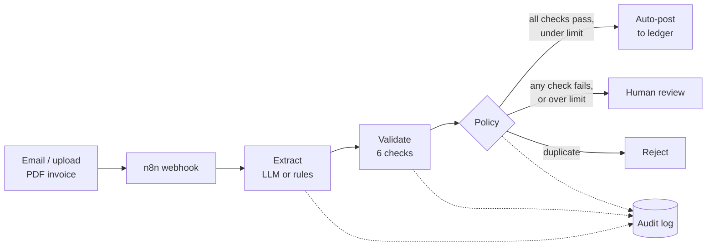

# Invoice intake automation

[](https://github.com/arafathossein/invoice-intake-automation/actions/workflows/tests.yml)
**Supplier invoices in, explained decisions out.** A small service that reads PDF invoices, extracts the fields, checks them, and routes each one to *auto-post*, *human review* or *reject* — with a reason for every decision and an audit trail of every step. Ships with an n8n workflow so it drops into an existing automation stack.

Built by [AFYRA Technologies](https://afyra-iota.vercel.app) as a reference implementation of human-in-the-loop document automation.

```
AUTO-POST  01_northwind_inv-2048.pdf
           Northwind Supplies Ltd | INV-2048 | total EUR 1488.00
           ✓ required_fields: All required fields present
           ✓ totals_add_up: 1240.00 + 248.00 = 1488.00
           ✓ dates_valid: Dates are consistent
           ✓ known_supplier: Matched to vendor V-0193
           ✓ not_duplicate: No earlier invoice with this number from this supplier
           ✓ confidence: All fields ≥ 90%

REVIEW     02_brightline_7731.pdf
           Brightline Logistics GmbH | 7731 | total EUR 3610.00
           ✗ totals_add_up: 3000.00 + 570.00 = 3570.00, not 3610.00
           ✗ dates_valid: Due date missing or unreadable
```

## The problem

Finance teams receive invoices as email attachments and type the values into their accounting system by hand. It's slow, errors slip through, and nobody can say afterwards why a wrong figure was posted.

Fully automatic extraction isn't the answer either: a model that is 95% accurate still posts one wrong invoice in twenty, silently. This project automates the routine cases and **stops for a person whenever anything looks wrong** — and it can always explain why.

## How it works



| Stage | What happens |
| --- | --- |
| **Extract** | An OpenAI-compatible model fills a fixed schema and scores its own confidence per field. Without a model configured, a deterministic rule-based extractor is used. If the model call fails, the pipeline falls back to rules and records that it did. |
| **Validate** | `required_fields`, `totals_add_up` (net + tax = total, ±0.01), `dates_valid`, `known_supplier` (vendor list), `not_duplicate` (supplier + invoice number), `confidence` (every field ≥ threshold). |
| **Decide** | Duplicate → **reject**. Any failed check → **review**. All passed but above the amount limit → **review**. Otherwise → **auto-post**. |
| **Record** | Every result is appended to `data/audit.jsonl`; accepted and pending invoices are registered so duplicates are caught later. |

Validation does more for accuracy than a bigger model: in the test suite, a model that copies a wrong total is caught by arithmetic, not by confidence.

## Results on the sample set

Five fictional invoices in [`samples/`](samples/), each built to exercise one path. Measured with the rule-based extractor (no API key):

| Sample | Expected | Result |
| --- | --- | --- |
| `01_northwind_inv-2048.pdf` — routine | auto-post | ✅ auto-post |
| `02_brightline_7731.pdf` — totals don't add up, unreadable due date, European number format | review | ✅ review |
| `03_northwind_inv-2048_resent.pdf` — same invoice sent twice | reject | ✅ reject |
| `04_orbital_inv-559.pdf` — supplier not in vendor list | review | ✅ review |
| `05_coastline_inv-9001.pdf` — valid but €12,402.50 | review | ✅ review |

These are illustrative samples, not a benchmark. On real documents, measure field-level accuracy and the share sent to review against your own baseline before switching anything on.

## Quick start

### Run it locally (Python 3.10+)

```bash
python -m venv .venv && source .venv/bin/activate   # Windows: .venv\Scripts\activate
pip install -e ".[dev]"

invoice-intake process samples/*.pdf        # routes all five samples
pytest                                      # 38 tests
invoice-intake serve --port 8000            # API docs at http://localhost:8000/docs
```

### Run the service and n8n together (Docker)

```bash
cp .env.example .env
docker compose up -d --build
```

Then in n8n (http://localhost:5678): **Import from file** → `n8n/invoice-intake.workflow.json` → **Publish**. Send a test invoice:

```bash
curl -X POST http://localhost:5678/webhook/invoice-intake \
  -F "invoice=@samples/02_brightline_7731.pdf;type=application/pdf"
```

```json
{
  "decision": "review",
  "action": "sent_to_review",
  "message": "Needs review: Brightline Logistics GmbH 7731. 3000.00 + 570.00 = 3570.00, not 3610.00 Due date missing or unreadable",
  "reasons": ["3000.00 + 570.00 = 3570.00, not 3610.00", "Due date missing or unreadable"]
}
```

The workflow has three clearly labelled *Prepare* nodes — swap them for your accounting system (QuickBooks, Xero, Exact…) and your review channel (Slack, Teams, email).

## Using a language model

Any OpenAI-compatible endpoint works. Set it in `.env`:

| Provider | `LLM_BASE_URL` | Notes |
| --- | --- | --- |
| OpenAI | `https://api.openai.com/v1` | Set `LLM_API_KEY` and `LLM_MODEL` |
| **Ollama (local)** | `http://localhost:11434/v1` | Invoices never leave your infrastructure |
| vLLM / LM Studio | your server's `/v1` URL | |

The model is told to copy values exactly and return `null` rather than guess; whatever it returns still goes through every validation check.

## API

| Method | Path | Body | Returns |
| --- | --- | --- | --- |
| `GET` | `/health` | — | status, active extractor, vendor count |
| `POST` | `/invoices` | multipart `file` (PDF, ≤10 MB) · `?dry_run=true` | full result |
| `POST` | `/invoices/text` | `{"text", "source", "dry_run"}` | full result |

If `SERVICE_API_KEY` is set, callers must send it as `X-API-Key`. Interactive docs at `/docs`.

## Configuration

| Variable | Default | Meaning |
| --- | --- | --- |
| `CONFIDENCE_THRESHOLD` | `0.90` | Minimum per-field confidence for auto-posting |
| `AUTO_POST_LIMIT` | `2000` | Totals above this always go to review |
| `VENDORS_CSV` | `config/vendors.csv` | Known suppliers (`vendor_id,name`) |
| `DATA_DIR` | `data` | Duplicate register and audit log |
| `LLM_BASE_URL` / `LLM_API_KEY` / `LLM_MODEL` | — | Optional model endpoint |
| `SERVICE_API_KEY` | — | Optional shared secret for the API |

## Project layout

```
src/invoice_intake/
  extract.py     rule-based and LLM extractors (one schema)
  rules.py       validation checks and routing policy
  pipeline.py    PDF → text → extract → validate → decide → record
  store.py       vendor list, SQLite duplicate register, JSONL audit log
  api.py         FastAPI service
  cli.py         command line
n8n/             importable workflow (tested on n8n 2.45.7)
samples/         fictional invoices + the script that generates them
tests/           parsing, rules, pipeline (incl. mocked LLM), API
```

## Design choices

- **Explainability first.** Every decision carries its reasons; every check reports what it compared.
- **People own the exceptions.** Failed checks never auto-post, whatever the model's confidence.
- **No lock-in.** Plain Python, an OpenAI-compatible API and a standard n8n workflow — each part replaceable.
- **Private by option.** Run the model locally and nothing leaves your network.

## Roadmap

- Review queue UI with the PDF beside the extracted fields
- Line-item extraction and PO matching
- OCR for scanned (image-only) PDFs
- Connectors for QuickBooks Online and Xero

## License

MIT — see [LICENSE](LICENSE). Sample invoices are fictional.
